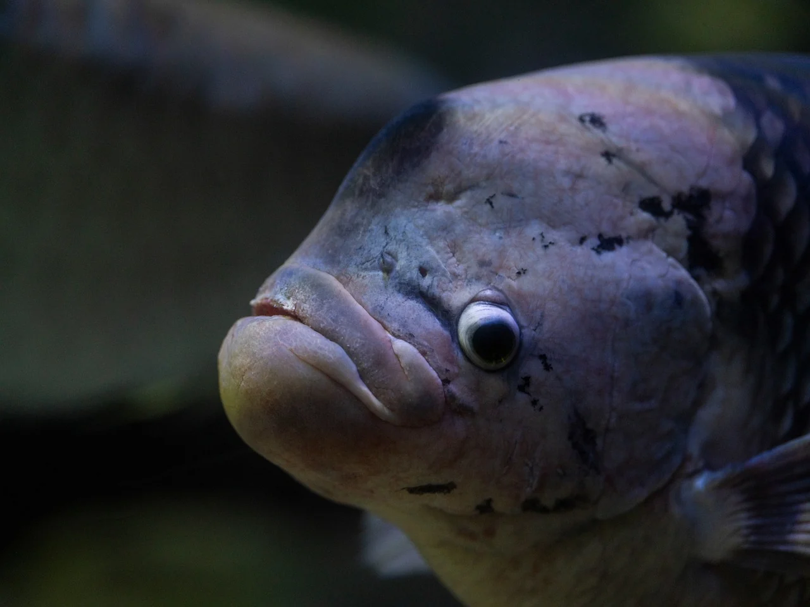

[text](../../animals/fish/giantGourami.html)
 Image by <a href="https://pixabay.com/users/mc_baris0-736090/?utm_source=link-attribution&utm_medium=referral&utm_campaign=image&utm_content=616465">mc_baris0</a> from <a href="https://pixabay.com//?utm_source=link-attribution&utm_medium=referral&utm_campaign=image&utm_content=616465"> Pixabay </a>
 Image by <a href="https://docs.google.com/document/d/1S3l3j189YysAytVpqQouj0EcM70wTMtZcIqZNcqZsj4/edit?tab=t.0"> Joshua Sherurcij </a> from <a href="https://commons.wikimedia.org/wiki/File:Osphronemus_Gourami_(better).png"> Wikipedia </a>
 Image by <a href="https://www.pexels.com/photo/large-white-fish-in-aquarium-with-rock-background-34486965/ "> Monamie Chakravarti </a> from <a href= "https://www.pexels.com/@monamie-chakravarti-1401404393/"> Pexels </a> 
 Image by <a href="https://pixabay.com/users/txuscruz0-1481759/?utm_source=link-attribution&utm_medium=referral&utm_campaign=image&utm_content=1402760">txuscruz0</a> from <a href="https://pixabay.com//?utm_source=link-attribution&utm_medium=referral&utm_campaign=image&utm_content=1402760"> Pixabay </a>
 Image by <a href="https://pixabay.com/users/engin_akyurt-3656355/?utm_source=link-attribution&utm_medium=referral&utm_campaign=image&utm_content=9398238">Engin Akyurt</a> from <a href="https://pixabay.com//?utm_source=link-attribution&utm_medium=referral&utm_campaign=image&utm_content=9398238"> Pixabay </a>
 Image by <a href="https://www.pexels.com/photo/large-white-fish-in-aquarium-with-rock-background-34486965/"> Anshu Kumar </a> from <a href= "https://www.pexels.com/@anshu/"> Pexels </a>